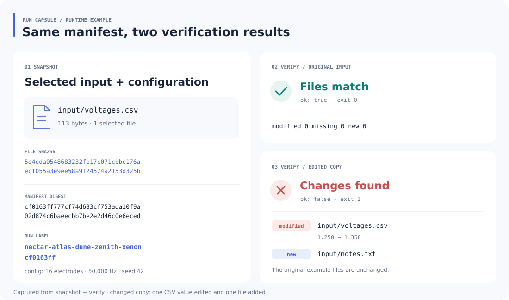

<p></p>

# Run Capsule

为实验输入生成一份可核验的清单：记录相对路径、文件大小、SHA256 和 JSON 配置，再给这次输入组合一个可读标签。搬到另一台机器后，可以检查文件是否缺失、修改或新增。

## 运行示例

下面对仓库的电压 CSV 建立清单，先核验原文件，再核验一份修改过数值、增加了笔记文件的副本。



左侧摘要来自 [本次清单](assets/demo-manifest.json)，右侧分别是 [修改前](assets/demo-before.json) 与 [修改后](assets/demo-after.json) 的实际核验结果。

需要 Python 3.10+。在项目根目录执行，无第三方依赖：

```sh
python -m run_capsule snapshot input --root examples \
  --config examples/config.json --output run.json
python -m run_capsule verify run.json --root examples
```

`snapshot` 打印运行标签；`verify` 输出 `ok`、`modified`、`missing`、`new` 和 `skipped_symlinks`。清单输出路径必须尚不存在，父目录须已存在。

图中差异可在副本上复现：

```sh
python -c "import shutil; shutil.copytree('examples', 'changed-example')"
python -c "from pathlib import Path; p=Path('changed-example/input/voltages.csv'); p.write_text(p.read_text().replace('1.250','1.350',1)); p.with_name('notes.txt').write_text('repeat measurement\n')"
python -m run_capsule verify run.json --root changed-example
```

最后一条退出 `1`，报告 `input/voltages.csv` 被修改、`input/notes.txt` 新增。原始样例不变。

## 选择哪些输入

```sh
python -m run_capsule snapshot input/voltages.csv config.json \
  --root examples --config examples/config.json --output selected-run.json
```

- 输入位置参数相对 `--root`，使用 `/` 分隔的相对路径；选择目录时递归包含普通文件。
- 选择单文件只核验该文件；选择目录还会报告目录内新增文件。重叠范围自动去重。
- 默认跳过点号隐藏项，使用 `--include-hidden` 可包含它们。
- 递归遇到的符号链接会跳过并列出；显式选择符号链接会报错。
- `--config`、`--output` 和清单路径相对当前工作目录。

清单在根目录内时，其路径会加入排除策略。要比较不同机器上的摘要，可统一清单相对路径，或将清单放在根目录外。

## 摘要记录了什么

清单包含选择范围、扫描策略、配置、文件路径和字节摘要。相同内容、配置与策略产生相同结果；时间戳、权限和空目录不计入摘要。

- `digest`：完整 SHA256，作为实验记录的身份。
- `label`：五个词加八位十六进制前缀，便于口头交流。
- `files`：每个文件的 `path`、`size`、`sha256`。
- `config`：创建时读取的 JSON 对象；核验时使用清单中的配置。

若要同时核验配置文件自身的变化，把它也加入输入位置参数，如上面的 `config.json`。JSON 字段和完整示例见 [examples/manifest.json](examples/manifest.json)。

摘要载荷由 `schema, inputs, policy, config, files` 组成，按 `sort_keys=True, separators=(",", ":"), ensure_ascii=False, allow_nan=False` 序列化为 UTF-8 后哈希。短标签用于交流，正式记录保留完整 `digest`。

退出码：`0` 创建成功或核验通过；`1` 文件存在差异；`2` 参数、清单或文件操作错误。

## 开发

```sh
python -m unittest discover -s tests -v
```

`core.py` 处理选择范围、流式哈希、清单身份与核验；`__main__.py` 提供 CLI。清单记录文件身份，数据副本和运行环境需另行保存。对已停止写入的输入目录执行快照，可保持记录一致。
